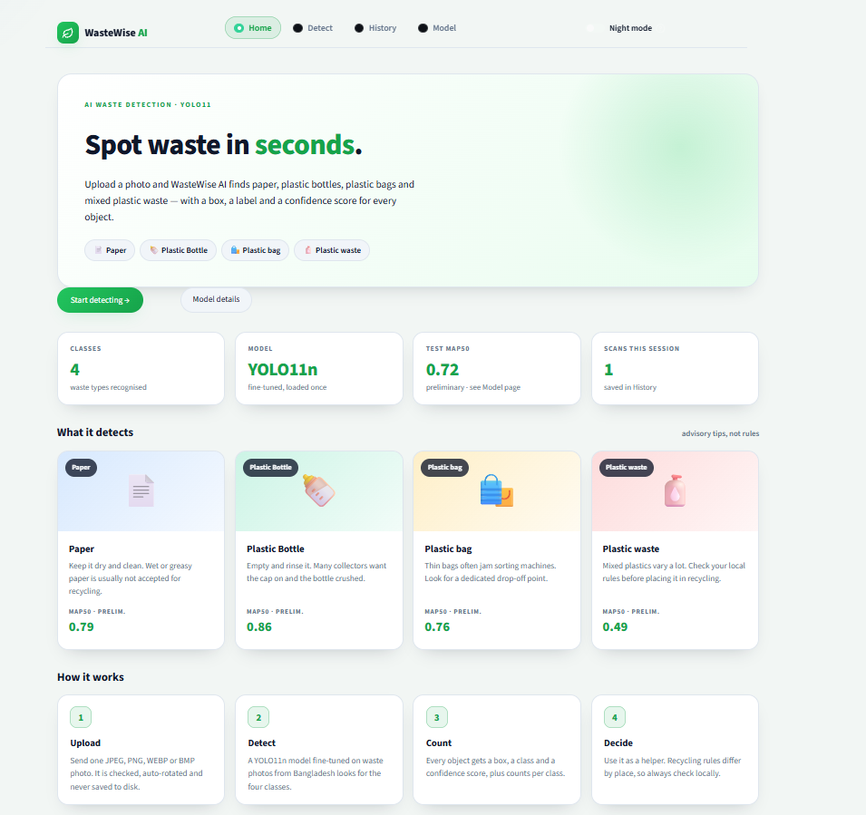
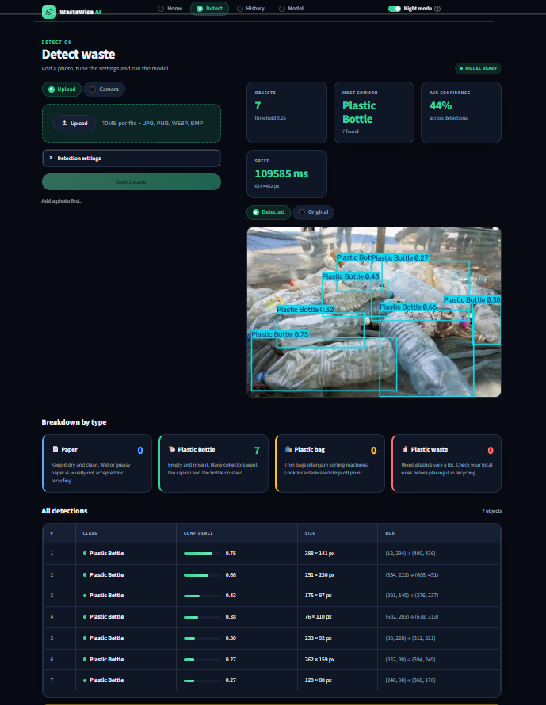

# ♻️ WasteWise AI

**AI-Powered Recyclable Waste Object Detection System**

WasteWise AI detects multiple waste objects in an image and returns a bounding box, predicted class, and confidence score for each detection, along with counts per class.

🌐 **Live Demo:** [Try WasteWise AI on Streamlit](https://wastewise-ai-hg7q42ygduko6ohgzrgwj2.streamlit.app/)

## 🎯 Project Purpose

The purpose of WasteWise AI is to use computer vision to identify common waste items and support recycling awareness in Bangladesh. It provides visual predictions to help users understand what types of waste appear in an image.

> **Note:** WasteWise AI is an advisory tool. It does not physically sort waste, and a prediction does not guarantee that an item is recyclable under local recycling guidelines.

## 🖼️ App Screenshots

### Home Interface



### Detection Results



> _Note: Make sure to save your two screenshot image files inside an `assets/` folder in your repository so they display correctly._

## ✨ Features

- **Multiple Object Detection:** Detect several waste objects in a single image.
- **Four Supported Classes:** Paper, Plastic Bottle, Plastic Bag, and Plastic Waste.
- **Bounding Boxes:** Display the locations of detected objects.
- **Confidence Scores:** Show the model's confidence for each prediction.
- **Class Counts:** Summarize the number of detected objects per class.
- **REST API:** Provide predictions through a FastAPI backend.
- **Interactive Demo:** Try the application through the live Streamlit interface.

## 🧠 Technology Stack

- **Programming Language:** Python
- **Model Training:** PyTorch, Ultralytics YOLO11n, transfer learning
- **Training Environment:** Google Colab
- **Backend API:** FastAPI, Uvicorn
- **Image Processing:** OpenCV, Pillow
- **Demo Interface:** Streamlit

## ⚠️ Important: Retrain Before Reporting Metrics

The initial Colab training run mixed overlapping dataset partitions, and the audit could not correctly read polygon labels. As a result, the evaluation metrics from that run may be overly optimistic, and its error analysis is unreliable.

Before reporting model performance, apply the fixes described in [`docs/notebook_fixes.md`](docs/notebook_fixes.md), retrain the model, and replace the outdated model weights and evaluation reports.

Do not treat metrics from the initial run as validated results.

## 📁 Project Structure

```text
WasteWise-AI/
├── notebooks/
│   └── WasteWise_AI_Colab_Training.ipynb
├── backend/
│   ├── app/
│   │   ├── main.py
│   │   ├── config.py
│   │   ├── api/
│   │   │   └── routes.py
│   │   ├── schemas/
│   │   │   └── detection.py
│   │   └── services/
│   │       ├── detector.py
│   │       ├── preprocessing.py
│   │       └── waste_mapping.py
│   ├── models/
│   │   ├── best.pt
│   │   └── model_metadata.json
│   ├── tests/
│   │   └── test_detection.py
│   ├── requirements.txt
│   └── .env.example
├── reports/
│   ├── dataset_audit.json
│   ├── evaluation.json
│   └── evaluation.md
├── docs/
│   ├── project_design.md
│   └── notebook_fixes.md
├── .gitignore
└── README.md
```

**Note:** The structure above describes the intended project layout. Ensure the listed files exist in your repository before treating it as the exact current structure. Model weights and reports must be generated or copied into their respective folders.

## 🚀 Run the Backend Locally

**Requirements:** Python 3.10 or later.

### 1. Clone the repository

```bash
git clone YOUR_GITHUB_REPOSITORY_URL
cd WasteWise-AI
```

Replace `YOUR_GITHUB_REPOSITORY_URL` with your actual GitHub repository URL.

### 2. Set up the Python environment

From the project root:

```bash
cd backend
python -m venv .venv
```

Activate the environment.

**Windows PowerShell:**

```powershell
.venv\Scripts\Activate.ps1
```

**macOS/Linux:**

```bash
source .venv/bin/activate
```

### 3. Install dependencies

```bash
pip install -r requirements.txt
```

PyTorch and Ultralytics may require a substantial download.

### 4. Configure environment variables

Copy the example environment file.

**Windows PowerShell:**

```powershell
Copy-Item .env.example .env
```

**macOS/Linux:**

```bash
cp .env.example .env
```

Adjust the configuration if necessary.

### 5. Start the API

```bash
uvicorn app.main:app --reload
```

Open the following URLs in your browser:

- **Swagger API documentation:** [http://127.0.0.1:8000/docs](http://127.0.0.1:8000/docs)
- **Health check:** [http://127.0.0.1:8000/api/v1/health](http://127.0.0.1:8000/api/v1/health)

The health endpoint should report whether the model loaded successfully. Ensure `best.pt` exists at the configured model path.

## 🧪 Test the Detection API

Send an image to the detection endpoint:

```bash
curl -X POST \
  "http://127.0.0.1:8000/api/v1/detect?confidence=0.25" \
  -F "file=@my_photo.jpg"
```

Replace `my_photo.jpg` with the path to an image on your computer.

To request an annotated image, if supported by your backend:

```text
/api/v1/detect?confidence=0.25&return_image=true
```

### Example Response

The following is an illustrative example, not a real model prediction.

```json
{
  "model_name": "WasteWise YOLO detector",
  "image_width": 1280,
  "image_height": 720,
  "confidence_threshold": 0.25,
  "detections": [
    {
      "class_id": 1,
      "class_name": "Plastic Bottle",
      "confidence": 0.93,
      "bbox": {
        "x_min": 40,
        "y_min": 35,
        "x_max": 180,
        "y_max": 260
      }
    }
  ],
  "counts_by_class": {
    "Paper": 0,
    "Plastic Bottle": 1,
    "Plastic Bag": 0,
    "Plastic Waste": 0
  },
  "inference_ms": 85.2,
  "annotated_image_base64": null
}
```

Bounding-box coordinates are pixel values relative to the original image, with the origin at the top-left corner.

### HTTP Status Codes

| Status | Meaning                             |
| ------ | ----------------------------------- |
| `200`  | Request processed successfully      |
| `400`  | Empty, corrupt, or unreadable image |
| `413`  | Upload exceeds the configured limit |
| `415`  | Unsupported image format            |
| `422`  | Invalid request parameter           |
| `500`  | Internal model or inference error   |
| `503`  | Model is not loaded                 |

These status codes describe the intended API behavior; verify them against the implemented backend.

## ⚙️ Configuration

The following variables are examples of the intended `backend/.env` configuration. Actual defaults depend on your implementation.

| Variable               | Example                      | Purpose                           |
| ---------------------- | ---------------------------- | --------------------------------- |
| `MODEL_PATH`           | `models/best.pt`             | Trained model location            |
| `METADATA_PATH`        | `models/model_metadata.json` | Model metadata location           |
| `CONFIDENCE_THRESHOLD` | `0.25`                       | Minimum detection confidence      |
| `IOU_THRESHOLD`        | `0.7`                        | Non-maximum suppression threshold |
| `IMAGE_SIZE`           | `640`                        | Model inference image size        |
| `MAX_UPLOAD_MB`        | `10`                         | Maximum upload size               |
| `DEVICE`               | `cpu`                        | Inference device                  |

## 🧪 Run Tests

From the `backend/` directory:

```bash
pytest
```

If the tests use a mock detector, they can validate API behavior without requiring a trained model or GPU. Follow the project test configuration for the exact coverage.

## 🏗️ How It Works

1. **Dataset Preparation:** Inspect and validate the waste detection dataset and annotations.
2. **Model Training:** Fine-tune a YOLO11n model in Google Colab.
3. **Evaluation:** Evaluate the trained model and review its errors.
4. **Model Export:** Save the trained weights as `best.pt`.
5. **Backend Inference:** Load the model through FastAPI and process image uploads.
6. **Result Presentation:** Return predicted classes, confidence scores, bounding boxes, and class counts to the client.

## 📊 Dataset and Licenses

**Dataset:** _A Curated Recyclable Waste Object Detection Dataset from Public Spaces in Southeastern Bangladesh_

- **Source:** [Zenodo Dataset](https://zenodo.org/records/22043339)
- **DOI:** [10.5281/zenodo.22043339](https://doi.org/10.5281/zenodo.22043339)
- **Dataset License:** CC BY 4.0, as identified for the dataset in the project documentation. Credit the dataset authors when using or redistributing the data.

Check the current Ultralytics licensing terms before commercial use. Dataset licensing and model-library licensing are separate considerations.

## ⚠️ Limitations

- The model supports only four trained waste classes.
- Small, dirty, occluded, or overlapping objects may be missed.
- Predictions depend on image quality and the model's training.
- Confidence scores do not guarantee correctness.
- Dataset coverage may not represent all waste types or environments in Bangladesh.
- Detecting an object does not establish whether it can be recycled locally.

## 👥 Team

## 🌱 Expected Impact

WasteWise AI aims to make waste identification more accessible, encourage recycling awareness, and demonstrate a practical computer vision application relevant to waste management in Bangladesh.

---

This project was developed by:

- **Kazi Sadman Zahin**
- **Abdur Rahman Tanvir**

**Try the live application:** [WasteWise AI — Streamlit Demo](https://wastewise-ai-hg7q42ygduko6ohgzrgwj2.streamlit.app/)

**Project status:** Model development, evaluation, and application integration should be considered ongoing until the corrected training run and reports have been validated.
